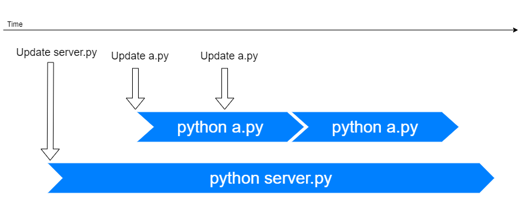
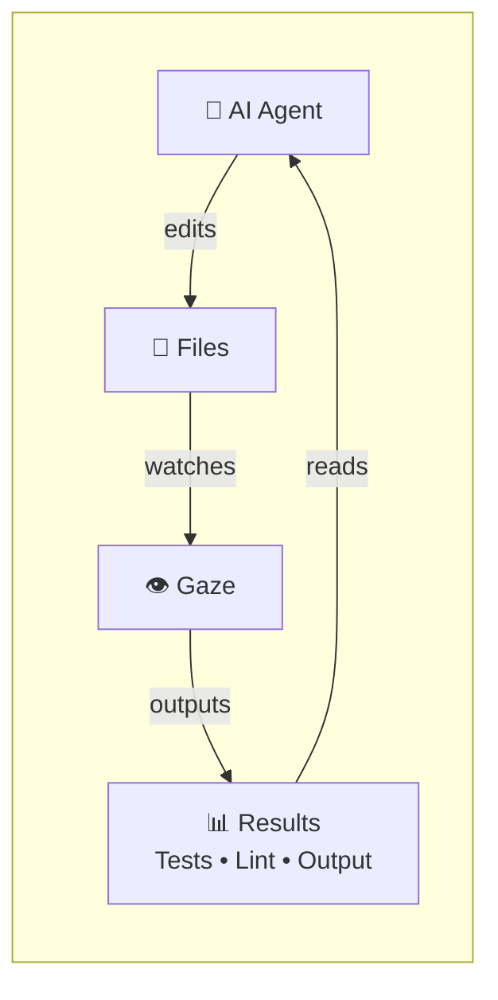

<p align="center">
  
</p>

<p align="center">
  <a href="https://github.com/wtetsu/gaze/actions?query=workflow%3ATest"></a>
  <!-- <a href="https://qlty.sh/gh/wtetsu/projects/gaze"></a> -->
  <a href="https://codecov.io/gh/wtetsu/gaze"></a>
  <a href="https://pkg.go.dev/github.com/wtetsu/gaze"></a>
</p>


# 👁️Gaze: Save & Run


Focus on your code, not commands!


----


😵‍💫 Rerunning commands after each edit disrupts your flow.

Let Gaze handle it!

- Save a.py -> 👁️Runs `python a.py`
- Save a.rb -> 👁️Runs `rubocop`
- Save a.go -> 👁️Runs `make build`
- Save Dockerfile -> 👁️Runs `docker build`
- And so forth...

## Installation

### Homebrew (macOS)

```
brew install gaze
```

Or, [download binary](https://github.com/wtetsu/gaze/releases) (macOS, Windows, Linux)

## Quick start


Setting up Gaze is easy.

```
# Gaze current directory
gaze .
```

Then, open your favorite editor in another terminal and start editing!


```
vi a.py
```


## Why Gaze? (Features)

Plenty of 'update-and-run' tools exist, but if you're coding, Gaze is the ideal choice — it's designed for coding flow.

- 📦 Easy to use, out-of-the-box
- ⚡ Lightning-fast response
- 🌎 Language-agnostic, editor-agnostic
- 🔧 Flexible configuration
- 📝 Create-and-rename file actions handling
- 🚀 Optimal parallel handling
  - See also: [Parallel handling](/doc/parallel.md)
  - 

## 🤖 Perfect with AI Agents!

Gaze works amazingly well with AI coding agents like Claude Code! Here's how this powerful combination works:



1. **AI Agent edits files** - Claude Code modifies your source files, configs, or data
2. **Gaze watches and runs** - Automatically executes tests, builds, linters, or data processing
3. **Results feed back** - AI Agent reads the output and continues the cycle


### Common AI + Gaze Patterns:
- 🧪 **Test-driven development**: Auto-run tests as AI writes code
- 📊 **Data pipeline**: Regenerate charts/reports when AI updates data
- 🔨 **Build automation**: Rebuild projects as AI modifies source
- 🚀 **Live development**: Restart servers when AI edits configs

This combo is a game-changer for AI-assisted development! 🚀


# How to use

Gaze prioritizes ease of use with its simple invocation.

```
gaze .
```

Then, switch to another terminal and run `vi a.py`. Gaze executes a.py in response to your file modifications.

---

Gaze at one file.

```
gaze a.py
```

---

Specify files using pattern matching (\*, \*\*, ?, {, })

```
gaze "*.py"
```

```
gaze "src/**/*.rb"
```

```
gaze "{aaa,bbb}/*.{rb,py}"
```

---

Specify a custom command by `-c` option.

```
gaze "src/**/*.js" -c "eslint {{file}}"
```

---

Kill the previous process before launching a new process. This is useful if you are writing a server.

```
gaze -r server.py
```

---

Kill a running process after 1000(ms). This is useful if you love infinite loops.

```
gaze -t 1000 complicated.py
```

---

Specify multiple commands within quotes, separated by newlines.

```
gaze "*.cpp" -c "gcc {{file}} -o a.out
ls -l a.out
./a.out"
```

Output when a.cpp was updated.

```
[gcc a.cpp -o a.out](1/3)

[ls -l a.out](2/3)
-rwxr-xr-x 1 user group 42155 Mar  3 00:31 a.out

[./a.out](3/3)
hello, world!
```

Gaze will not execute subsequent commands if a command exits with a non-zero status.


```
[gcc a.cpp -o a.out](1/3)
a.cpp: In function 'int main()':
a.cpp:5:28: error: expected ';' before '}' token
   printf("hello, world!\n")
                            ^
                            ;
 }
 ~
exit status 1
```

### Configuration

Gaze is language-agnostic.

For convenience, it provides helpful default configurations for a variety of popular languages (e.g., Go, Python, Ruby, JavaScript, Rust, etc.).


```
gaze a.py
```

By default, this command is equivalent to `gaze a.py -c 'python "{{file}}"'` because the default configuration includes:

```yaml
commands:
- ext: .py
  cmd: python "{{file}}"
```


You can view the default YAML configuration using `gaze -y`.


<details>
<summary>⚙️The default configuration</summary>

```yaml
commands:
- ext: .go
  cmd: go run "{{file}}"
- ext: .py
  cmd: python "{{file}}"
- ext: .rb
  cmd: ruby "{{file}}"
- ext: .js
  cmd: node "{{file}}"
- ext: .d
  cmd: dmd -run "{{file}}"
- ext: .groovy
  cmd: groovy "{{file}}"
- ext: .php
  cmd: php "{{file}}"
- ext: .java
  cmd: java "{{file}}"
- ext: .kts
  cmd: kotlinc -script "{{file}}"
- ext: .rs
  cmd: |
    rustc "{{file}}" -o"{{base0}}.out"
    ./"{{base0}}.out"
- ext: .cpp
  cmd: |
    gcc "{{file}}" -o"{{base0}}.out"
    ./"{{base0}}.out"
- ext: .ts
  cmd: |
    tsc "{{file}}" --outFile "{{base0}}.out"
    node ./"{{base0}}.out"
- ext: .zig
  cmd: zig run "{{file}}"
- re: ^Dockerfile$
  cmd: docker build -f "{{file}}" .

log:
  start: "[{{command}}]{{step}}"
  end: "({{elapsed_ms}}ms)"
```

</details>

---

To customize your configuration, create your own configuration file:


```
gaze -y > ~/.gaze.yml
vi ~/.gaze.yml
```

Gaze searches for a configuration file in the following order:

1. A file specified by -f option
1. ~/.config/gaze/gaze.yml
1. ~/.gaze.yml
1. (Default)


### Options:

```
Usage: gaze [options] file(s)

Options:
  -c <command>    Command(s) to run when files change.
  -r              Restart mode: send SIGTERM to the running process before starting the next command.
  -t <time_ms>    Timeout (ms): send SIGTERM to the running process after the specified time.
  -f <file>       Path to a YAML configuration file.
  -v              Verbose mode: show additional information.
  -q              Quiet mode: suppress normal output.
  -y              Show the default YAML configuration.
  -h              Show help.
  --color <mode>  Set color mode (0: plain, 1: colorful).
  --version       Show version information.

Examples:
  gaze .
  gaze main.go
  gaze a.rb b.rb
  gaze -c make "**/*.c"
  gaze -c "eslint {{file}}" "src/**/*.js"
  gaze -r server.py
  gaze -t 1000 complicated.py

For more information: https://github.com/wtetsu/gaze
```

### Command format

You can use [Mustache](<https://en.wikipedia.org/wiki/Mustache_(template_system)>) templates in your commands.

```
gaze -c "echo {{file}} {{ext}} {{abs}}" .
```

| Parameter | Example                   |
| --------- | ------------------------- |
| {{file}}  | src/mod1/main.py          |
| {{ext}}   | .py                       |
| {{base}}  | main.py                   |
| {{base0}} | main                      |
| {{dir}}   | src/mod1                  |
| {{abs}}   | /my/proj/src/mod1/main.py |


# Third-party data

- Great Go libraries
  - See [go.mod](https://github.com/wtetsu/gaze/blob/master/go.mod) and [license.zip](https://github.com/wtetsu/gaze/releases)
